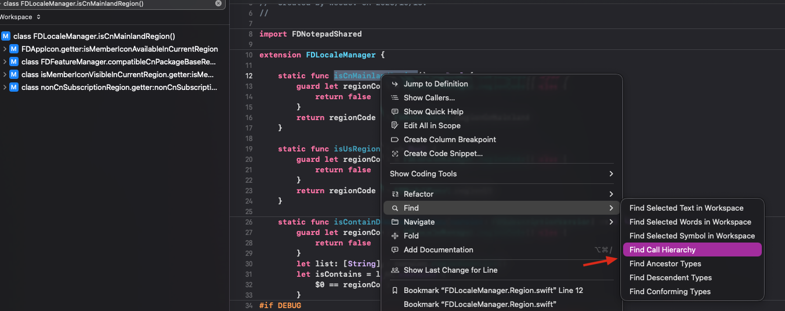
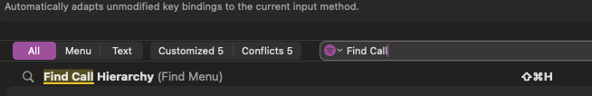

# Xcode

## 简介

Xcode 是 Apple 官方集成开发环境（IDE），用于开发 iOS / iPadOS / macOS / watchOS / tvOS 应用，内置模拟器、调试器、Instruments 性能分析工具与 Swift / Objective-C 编译工具链。

- 官网：[Xcode - Apple Developer](https://developer.apple.com/xcode/)
- 官方帮助文档：[Xcode help](http://help.apple.com/xcode/mac/8.0/#/dev466720061)
- 轻量级替代编辑器：[CodeEditApp](https://github.com/CodeEditApp/CodeEdit/releases/) 轻量级 xcode，可以尝试

## 实用功能

### Find Call Hierarchy（查找调用层级）

在方法上触发 Find Call Hierarchy，会以树形展示该方法的完整调用链（谁调用了它、层层向上追溯），在分析陌生调用链或重构前确认影响范围时，比逐个跳转定义更直观。



入口与快捷键操作路径：



## 常见问题

### Xcode 链接 iPhone 一直闪断


发现一个 Xcode 链接 iPhone 一直闪断的问题，提示说软件下载更新才能连接，但是下载失败，还以为是数据线接触不良或者是 Xcode 版本不支持，后来发现开启省电模式就可以了。

[A software update is required to connect to your iOS device / iPhone - Ask Different](https://apple.stackexchange.com/questions/327310/a-software-update-is-required-to-connect-to-your-ios-device-iphone)

```
The problem can be fixed by installing XCode beta.
This error occurs when the version of macOS (and iTunes) running on the computer is not compatible with the version of iOS on the device you're trying to connect.

Normally, updating the macOS to its current version will solve the problem. However, this won't work if the iOS device is running a newer beta version, and the Mac is not.
```

### 使用 Clang(LLVM) 将 OC 文件转为 C/C++ 文件报错

```objc

main.m:9:9: fatal error: 'UIKit/UIKit.h' file not found
#import <UIKit/UIKit.h>
    ^
1 error generated.
```

需要用 `-isysroot` 指定模拟器 SDK 路径：

```objc
clang -x objective-c -rewrite-objc -isysroot /Applications/Xcode.app/Contents/Developer/Platforms/iPhoneSimulator.platform/Developer/SDKs/iPhoneSimulator.sdk xxx.m

// __weak 修饰变量，需要告知编译器使用 ARC 环境及运行时版本号，否则会报错，添加说明：
-fobjc-arc -fobjc-runtime=ios-8.0.0

xcrun -sdk iphoneos clang -arch arm64 -rewrite-objc -fobjc-arc -fobjc-runtime=ios-8.0.0 main.m
```

## Xcode 生态工具

| 工具 | 说明 |
| --- | --- |
| [PPAutoPackageScript](https://github.com/jkpang/PPAutoPackageScript) | Xcode 自动打包脚本 |
| [XAssistant](https://github.com/icofans/XAssistant) | 桌面打包 IPA 小程序，支持蒲公英分发 |
| [InjectionForXcode](https://github.com/johnno1962/injectionforxcode) | Xcode 热注入插件，无需重新编译即可查看代码修改效果 |
| [PPRows](https://github.com/jkpang/PPRows/releases) | 代码行数统计工具 |
| [xTextHandler](https://github.com/cyanzhong/xTextHandler) | Xcode Source Editor 插件集 |
| [CornerStone](https://itunes.apple.com/us/app/cornerstone-3/id1110740402?mt=12) | 优秀的 SVN 客户端 |
| [Prepo](https://itunes.apple.com/tw/app/prepo/id476533227?mt=12) | App 图标和启动图预览工具 |
| [Easy APNs Provider](https://itunes.apple.com/cn/app/easy-apns-provider-%E6%8E%A8%E9%80%81%E6%B5%8B%E8%AF%95%E5%B7%A5%E5%85%B7/id989622350?mt=12) | 苹果推送服务测试工具 |
| [App Icon Gear](http://www.cocoachina.com/bbs/read.php?tid-290247-fpage-4.html) | 创建 App 图标、启动图和自定义尺寸图标集 |
| [UIDebuggingInformationOverlay](http://ryanipete.com/blog/ios/swift/objective-c/uidebugginginformationoverlay/) | UI 调试信息覆盖层，苹果私有调试工具 |
| [PaintCodeApp](https://www.paintcodeapp.com/) | 将绘图转换为代码 |
| [Provisioning](https://github.com/chockenberry/Provisioning) | .mobileprovision 文件快速查看插件 |
| [Core-Animator](http://xclient.info/s/core-animator.html?_=7f6b20915b1318a0839df0a326a089e5) | iOS/OS X 动画制作工具，导出 Swift/Objective-C 代码 |
| [PaintCode for Sketch](http://xclient.info/s/paintcode-for-sketch.html?_=7f6b20915b1318a0839df0a326a089e5) | 将 Sketch 绘图转为代码 |
| [Sketch](https://www.jianshu.com/p/3590f089e500) | 矢量图形设计工具 |
| [XcodeCleaner](https://github.com/waylybaye/XcodeCleaner) | Xcode 缓存统计清理 |

## 插件与集成

### XVim2 —— Vim 键位绑定

[XVimProject/XVim2: Vim key-bindings for Xcode 9](https://github.com/XVimProject/XVim2)

[记：在 Xcode 10 中安装 XVim2 - 风萧萧](https://note.wuze.me/xvim2)

Xcode 插件需要自签名证书重新签署 Xcode 后才能加载：

1. 签署 Xcode：关闭 Xcode
2. 打开 钥匙串访问
3. 选择 钥匙串访问 -> 证书助理 -> 创建证书
   - 名称：XcodeSigner（可随意）
   - 身份类型：自签名根证书
   - 证书类型：代码签名
4. 重新签署 Xcode：

```objc
# XcodeSigner 为创建证书时输入的名称
sudo codesign -f -s XcodeSigner /Applications/Xcode.app
```

### WakaTime —— 代码时间统计

[WakaTime For Xcode](https://wakatime.com/help/plugins/xcode)

1. 退出 `Xcode` 进程
2. 终端执行安装命令：

`curl -fsSL https://raw.githubusercontent.com/wakatime/xcode-wakatime/master/install.sh | sh`

3. `Xcode` 会弹出加载插件的提示，点击 `Load Bundles`
4. 提示输入 `WakaTime` 的 API Key（在个人账号信息中）

完整使用说明（第三方集成 / FAQ / 项目管理）见 [工具-WakaTime](../../../Awesome效率神器/效率工具/工具-WakaTime.md)。

### Injection for Xcode —— 热注入调试

允许在不重启应用的情况下注入代码更改，快速查看 UI 与逻辑修改效果。详见 [injectionforxcode](../调试工具/injectionforxcode.md)。

## 相关文档

- [工具-Appcode](../../../Awesome效率神器/开发工具/工具-Appcode.md)：AppCode 各视图/导航器与 Xcode 对应功能对照
- [App启动时间优化](../../../Awesome效率神器/开发工具/App启动时间优化%20.md)：添加环境变量后用 Xcode 控制台输出 pre-main 耗时
- [技巧-Mac存储清理](../../../电脑设备技巧/Mac技巧/技巧-Mac存储清理.md)：清理 Xcode 缓存与项目构建数据/索引
- [Mac的自动化](../../../Mac的自动化.md)：AppleScript 驱动 Xcode 编译工程
- [Mac相关问题](../../../问题issue/Mac相关问题.md)：Command Line Tools 安装（App Store 安装 Xcode 并至少运行一次 + `xcode-select --install`）
